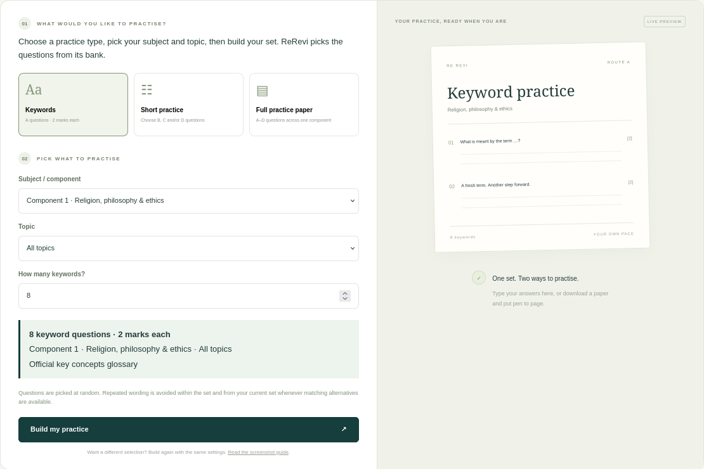
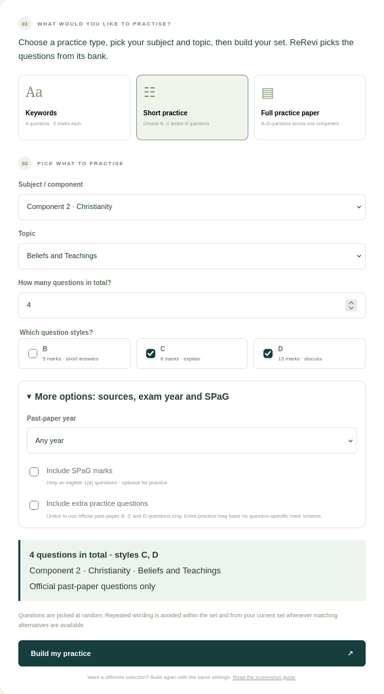
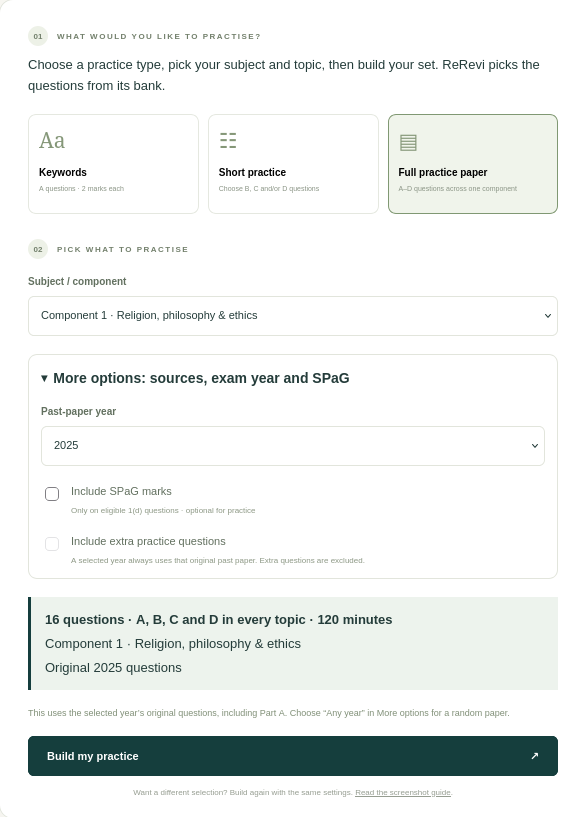
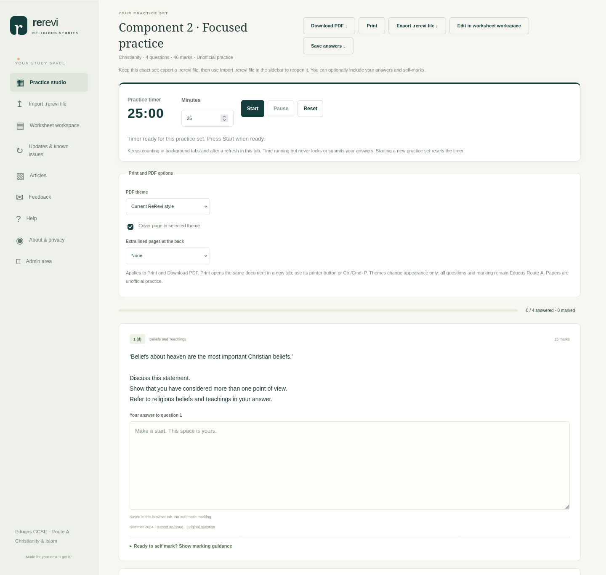
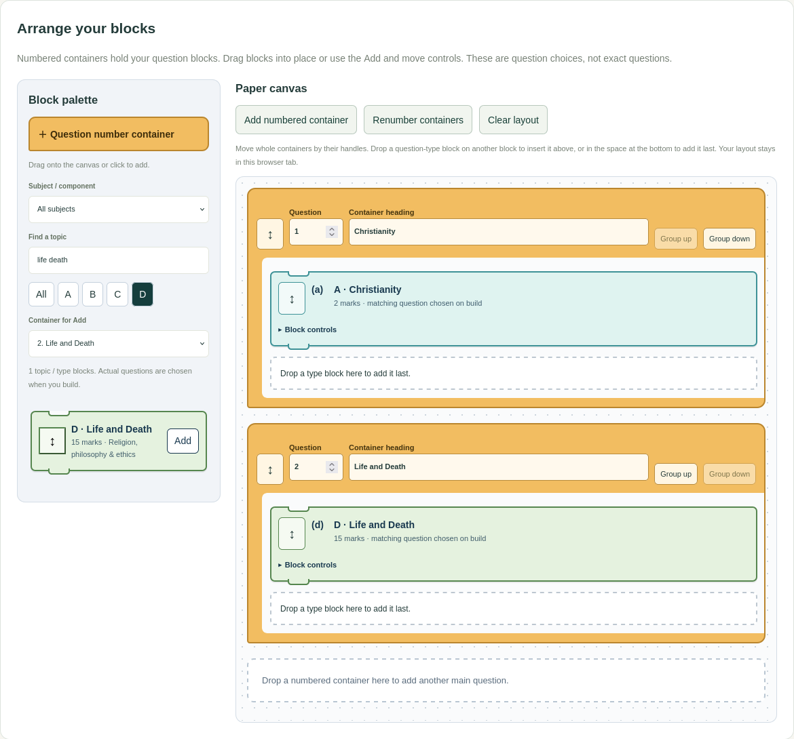

**TL;DR:** Choose **Keywords**, **Short practice** or **Full practice paper**, pick what you want to revise, check the green summary, then press **Build my practice**. You can answer online, download a PDF or save the exact set as a `.rerevi` file.

ReRevi's randomiser picks questions from its question bank. It doesn't write new questions while you use it. Here's how to get a set that suits the revision you want to do.

## 1. Choose your practice type

- **Keywords** gives you Part A questions worth 2 marks each. Choose a topic and how many terms you want to practise. This is useful for a quick definitions check.
- **Short practice** lets you choose B, C and/or D questions. B questions are worth 5 marks, C questions 8, and D questions 15. You can select more than one style.
- **Full practice paper** builds A, B, C and D questions for every topic in your chosen component. It gives you a complete paper-shaped set rather than asking you to choose a question count.

Choose **Subject / component** next: Component 1, Christianity or Islam. Keywords and short practice also let you choose one **Topic** or keep **All topics** selected.

## 2. Set the amount and check the summary

For keywords, enter how many terms you want. For short practice, enter the **total number of questions**, then tick the styles you want.

For example, 4 questions with C and D selected means **four questions altogether**, drawn from those styles. It does not mean four of each, and it doesn't guarantee an equal split. Use the worksheet workspace if you want to assemble a particular combination yourself.

The green summary tells you the amount, component, topic and question sources before you build. If it doesn't describe the set you want, change the controls above it.

## 3. Use More options when you need them

Keywords use the official glossary. For short practice and full papers, open **More options: sources, exam year and SPaG** to change the following:

- **Past-paper year:** **Any year** gives the randomiser a wider pool. Selecting a particular year restricts questions to that original paper. In full-paper mode, Part A also uses that year's original keyword questions. Rebuilding a fixed-year paper may therefore give the same questions again.
- **Include extra practice questions:** untick this for official past-paper questions only. Additional Christianity and Islam practice questions are AI-generated, are labelled as additional practice and have no question-specific indicative content. You can leave them out entirely using this option.
- **Include SPaG marks:** this is optional for practice and applies only to eligible questions. It isn't offered for Islam.

A full Component 1 practice paper has 16 questions and a suggested 120 minutes. Christianity and Islam papers have 8 questions and 60 minutes each. Those durations exclude any extra time you choose to give yourself.

## How to leave out AI-generated practice questions

**You do not have to use AI-generated questions.** If you prefer to practise using official questions and glossary terms only:

1. In the **Practice studio**, open **More options: sources, exam year and SPaG**.
2. **Untick Include extra practice questions** before pressing **Build my practice**. The summary should say **Official past-paper questions only**. Keyword practice already uses the official glossary.
3. In **Worksheet workspace**, **tick Omit extra practice questions** before building or choosing new questions.

These controls exclude **all additional practice**, including AI-generated questions and extra questions from other sources. They are not an AI-only filter. Official question papers are not AI-generated by ReRevi.

Changing a filter does not remove questions already in your current set or a reopened `.rerevi` file. Rebuild your practice with the option set, or remove any additional questions from the worksheet yourself. Save any work you want to keep before replacing the set.

If you do choose to include additional Christianity and Islam practice, remember that it has **no question-specific indicative content**. General marking criteria describe answer quality; they do not provide a model answer or guarantee that an AI-generated question is free from errors.

## 4. Build, answer and keep your work

Press **Build my practice**. ReRevi takes you to the selected questions. Type your answers on the page, use the optional timer, then reveal the marking guidance and self-mark when you're ready. Missing indicative content is not an answer key; additional practice may provide general marking criteria only.

Prefer paper? Use **Download PDF** or **Print**. The PDF options let you choose ReRevi or Eduqas booklet styling, a cover and extra lined pages.

To keep this **exact selection**, choose **Export .rerevi file**. You can optionally include your answers and self-marks. Use **Import .rerevi file** in the sidebar to reopen it later, including on another device. Keep files containing your answers private.

## Want a different selection?

Press **Pick another set**, or change the settings and press **Build my practice** again. ReRevi tries to avoid repeated wording within the set and from your current set, even when the same wording appears in more than one bank record. Repeats can still happen when your filters leave too few alternatives, or when a selected year requires the original questions. This isn't a permanent record of every question you've ever practised.

If you've started answering, ReRevi asks before replacing your set. Export your practice file first if you want to keep the questions and work together.

If the bank doesn't have enough matching questions, reduce the number or widen the topic, style or year filters.

## For more control, use Worksheet workspace

The worksheet workspace lets you pick individual questions, start from a component or topic template, or use **Pick random questions** and **Pick questions to match marks**. Apply its filters first; those buttons replace the current set. You can also edit the front page visually, preview the PDF and make worksheet versions.

## Build your paper: a separate tab for topic / type blocks

The worksheet workspace keeps its simpler question list, preview, answering and PDF tools. Choose the separate **Build your paper** tab above it, or use the sidebar link, when you want to design a paper layout with blocks.

The blocks represent **themes and question types, not exact questions**. For example:

- **A · Christianity** means “pick a Christianity keyword question when I build”. It does not lock the block to a keyword such as Evangelism.
- **D · Life and Death** means “pick a matching Life and Death discussion question when I build”. It does not lock the block to a particular statement about euthanasia or another issue.

Numbered containers act like functions in a block editor: the topic/type blocks inside are their question choices.

1. Drag **Question number container** from the **Block palette** onto the **Paper canvas**, or click it to add one.
2. Edit the container's number and heading.
3. Choose a subject, theme and A/B/C/D type in the palette. Drag a type block into a container, or select a destination and press **Add**. You can add the same type more than once if you want several matching questions.
4. Move whole containers or individual blocks into order. **Block controls** lets you edit a subquestion label, move a block using buttons or a menu, or remove it.
5. Check **Omit extra practice questions** to exclude all additional practice, including AI-generated questions. Optional SPaG still follows the original questions' eligibility.
6. Press **Build paper**. Only now does ReRevi choose the actual questions for your blocks. Build again to choose alternatives where available; your block layout stays the same.
7. Select **Open in worksheet workspace** to see the chosen questions, type answers and make PDFs, or **Export .rerevi file** to keep the exact selection. You are asked before replacing a worksheet with written work.

**Start from a layout** can create a full component or one topic's block arrangement. Full component layouts add SPaG only where assessed; topic layouts leave it off by default. Your layout stays in this browser tab. Export a `.rerevi` file after building if you want to keep its exact questions.

Back in **Worksheet workspace**, the original sections are **1. Your worksheet**, **2. Choose questions**, **3. Preview, order and practise**, **4. Print and download** and **5. Share selected answers**. Its existing question bank and paper/topic templates remain available. Papers opened from the builder retain their display numbering; ordinary worksheet selection still works as before.

Found a confusing label or a question that needs checking? Use the question's report control or the [feedback page](/feedback/). Your feedback helps make ReRevi easier to use.

**Zafir Shirazi**
